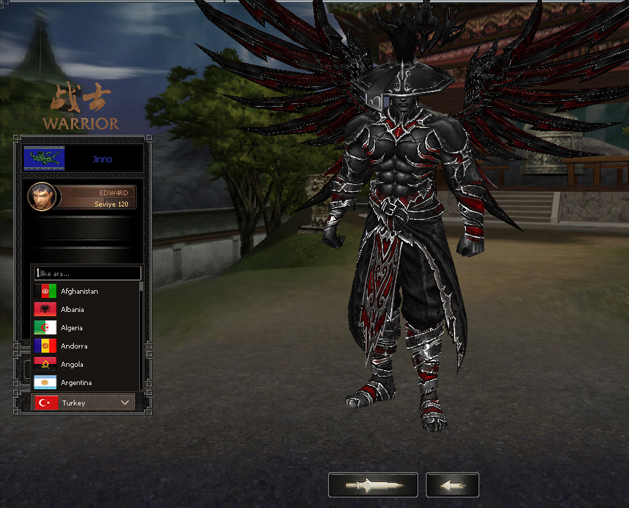

# Country Flag System

Ülke bayrağı. Karakter başına bayrak seçimi; bayrak sohbette, isim etiketinde, fısıltıda ve armada görünür.



---

## Ne var?

- Bayrak seçim penceresi (`uicountryflag.py`) ve karakter seçim ekranı
- Sohbet, isim etiketi, fısıltı ve lonca arması yanında bayrak
- Tek boyutlu bayrak seti (`ui/language_system/flags/`)
- `player.country_flag` kolonu

## Paket yapısı

```
01. Svn/          → Client & Game source (Ara / Altına ekle / Bul / Değiştir patch dosyaları + yeni dosyalar)
02. Client/       → root, uiscript, locale, d_/ymir work assetleri
03. Server/       → MySQL tabloları, quest ve sunucu verileri
Added/            → Değişikliklerin uygulanmış hali (tam dosyalar, karşılaştırma için)
```

## Flagler

**Client** (`Locale_inc.h`):
- `ENABLE_COUNTRY_FLAG`

**Game** (`service.h`):
- `ENABLE_COUNTRY_FLAG`

Client ve game tarafında aynı isimli flagler birlikte açık olmalı; tek taraf açıkken paket / komut uyumsuzluğu olur.

## Kurulum (kısaca)

1. `01. Svn` altındaki patch dosyalarını kendi source ağacına uygula. Her blokta `// Ara:` satırlarını bul, `// Altına ekle:` kısmını altına ekle; `// Bul:` / `// Degistir:` bloklarında bulduğun satırları verilen blokla değiştir.
2. `02. Client/root` ve `02. Client/uiscript` içindeki tam dosyaları pack'e kopyala, patch dosyalarını (`# Ara:` / `# Altına ekle:`) kendi dosyalarına uygula.
3. `02. Client/locale/<dil>/` satırlarını kendi locale dosyalarının sonuna ekle.
4. `02. Client/d_/ymir work/` görsellerini pack'e ekle (`d:/ymir work/...`).
5. `03. Server` içindeki SQL ve verileri sunucuya uygula.
6. Client + game + db rebuild, pack güncelle.

## Bağımlılıklar

- `advanced_options_reference.py` patch'i yalnızca **Advanced Game Options** paketi kuruluysa gerekli.
- `advanced_options_runtime.py` patch'i yalnızca **Advanced Game Options** paketi kuruluysa gerekli.
- `uiadvancedgameoptions.py` patch'i yalnızca **Advanced Game Options** paketi kuruluysa gerekli.
- `uiwhispermessenger.py` patch'i yalnızca **Chat Tabs & Whisper Messenger** paketi kuruluysa gerekli.

## Notlar

- Locale dosyalarında yalnızca bu sisteme ait anahtarlar var; `new_locale_*` kendi eklediğimiz, `locale_game` / `locale_interface` resmi istemcide olmayan anahtarlar. Türkçe dosyalar cp1254.
- Patch'lerde başka sistemlere ait satırlar görürsen (farklı `#ifdef`), o sistem sende yoksa yok say.
- Fork farklıysa paket header / struct sıralamasını kontrol et.

---

## İletişim

Sorular için Discord'dan yazabilirsin.

| | |
|---|---|
| GitHub | [github.com/ybeststudio](https://github.com/ybeststudio) |
| Discord | [discord.gg/NXmc6JrwYr](https://discord.gg/NXmc6JrwYr) |
| Discord ID | `beststudio` |
| Web | [bestpro.dev](https://bestpro.dev) |
| TurkMMO | [Best Studio](https://forum.turkmmo.com/uye/2104546-best-studio/) |
| YouTube | [@ybeststudio](https://www.youtube.com/@ybeststudiotr) |
| Instagram | [@ybeststudio](https://www.instagram.com/ybeststudio) |
| Facebook | [ybeststudio](https://www.facebook.com/ybeststudio/) |
| Twitter | [@ybeststudio](https://twitter.com/ybeststudio) |
| TikTok | [@ybeststudio](https://tiktok.com/@ybeststudio) |

---

**Best Studio** — Metin2 private server çözümleri
